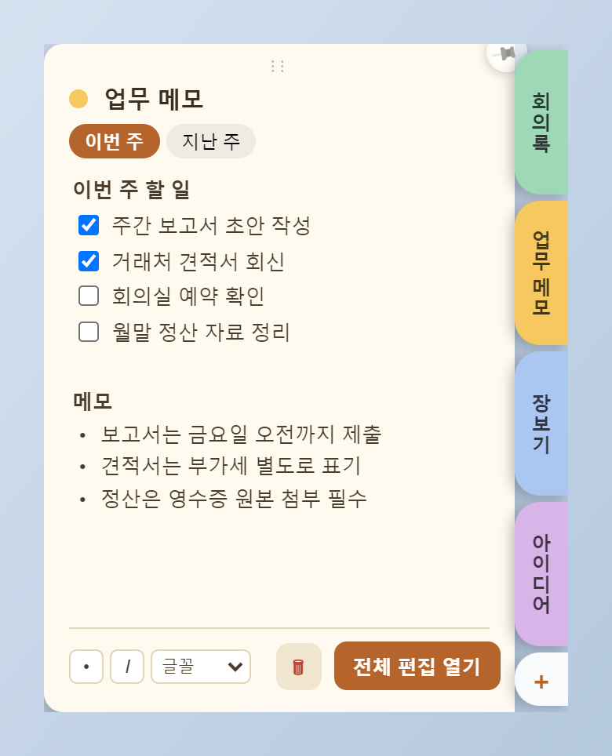
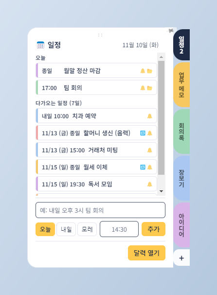
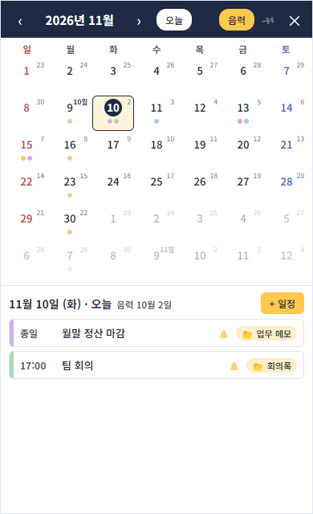
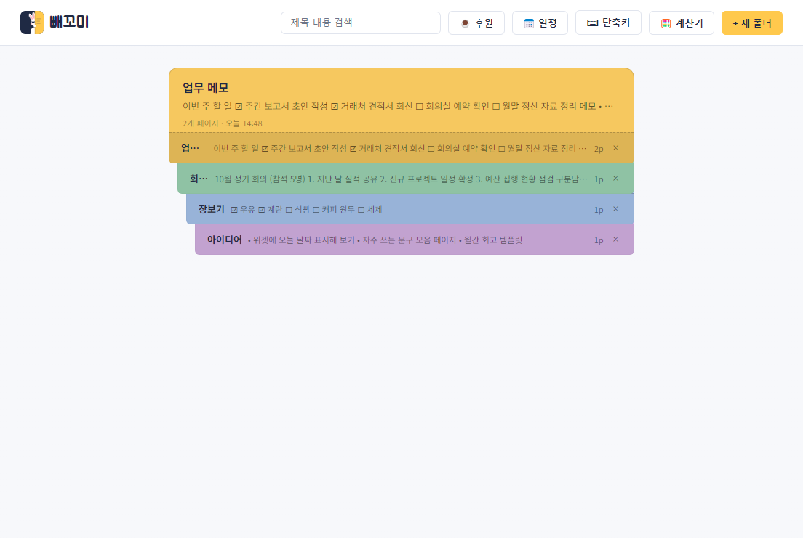
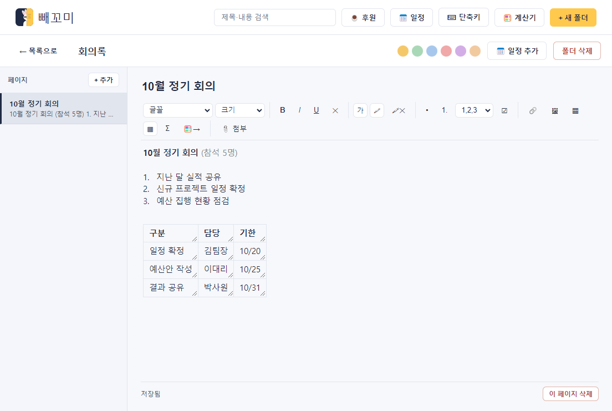
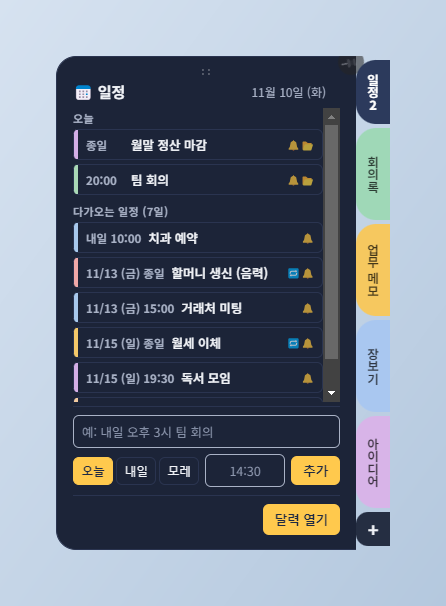

# 빼꼬미 (Peekomi)

화면 오른쪽 끝에 숨어 있다가, 필요할 때 빼꼼 나오는 Windows용 메모·일정 위젯입니다. 마우스를 올리면 바로 펼쳐져서 메모를 보고 고치고, 오늘 일정과 알림까지 한 곳에서 챙길 수 있어요. (예전 이름: 메모함 / Memo Cabinet)

**[⬇ 설치 파일 받기 (최신 버전)](https://github.com/David-Kimbit/Memo/releases/latest)** — `memo-cabinet-setup-<버전>.exe`를 받아 실행하면 돼요. 한 번 설치하면 이후 업데이트는 자동으로 알려줘요.

<p align="center">
  
  
</p>

## 이렇게 생겼어요

**위젯** — 평소에는 화면 가장자리에 얇게 숨어 있고(마우스가 그대로 통과해서 뒤의 창을 가리지 않아요), 탭에 마우스를 올리면 부드럽게 펼쳐집니다. 열린 채로 바로 글을 쓰고 체크할 수 있어요. 맨 위의 **일정** 탭에서는 오늘 일정과 앞으로 7일 일정을 보고 바로 추가해요.

**달력** — 공휴일과 음력이 함께 보이는 월간 달력에서 일정을 만들고 고쳐요. 일정마다 메모 폴더를 연결할 수 있어요.

<p align="center">
  
</p>

**폴더** — 폴더를 서류철처럼 쌓아 보고, 겹쳐진 폴더에 마우스를 올리면 요약이 미리 보여요.



**편집기** — 폴더 안에 여러 페이지를 두고, 서식·표·체크리스트까지 쓸 수 있는 전체 편집 창입니다.



## 주요 기능

**화면 테마**
- 라이트·다크 테마를 지원해요. 기본은 Windows 설정을 따라가고, 상단 `🌓` 버튼이나 트레이 메뉴 → 화면 테마에서 라이트/다크로 고정할 수 있어요

<p align="center">
  
</p>

**위젯**
- 마우스를 올리면 펼쳐지고, 📌으로 고정할 수 있어요
- 위쪽 손잡이를 끌어 위치를 옮기고, 탭을 끌어서 순서를 바꿔요
- 마우스가 있는 모니터를 따라 이동해요
- 위젯에서 바로 글머리 기호·기울임·글꼴을 바꾸고 폴더를 삭제할 수 있어요

**일정·알림**
- 위젯 맨 위의 **일정** 탭에 마우스를 올리면 오늘 일정과 앞으로 7일 일정이 보이고, 그 자리에서 바로 추가할 수 있어요. 문장으로 써도 돼요: `내일 오후 3시 팀 회의`, `금요일 저녁 7시 반 회식`, `11/20 14:00 치과`, `3일 뒤 오전 10시 점검` (입력하는 동안 어떻게 읽었는지 미리 보여줘요)
- 달력에 **한국 공휴일**(대체공휴일 포함)과 **음력 날짜**가 표시돼요. 음력 표시는 상단 `음력` 버튼으로 끌 수 있어요. (선거일·임시공휴일은 앱에 들어 있는 것만 표시되고, 새로 지정되는 임시공휴일은 업데이트로 추가해야 해요)
- 일정을 만들 때 **음력 날짜를 입력해서 양력으로 바꿀 수** 있고, **매년 (음력)** 반복으로 음력 생일·제사를 등록할 수 있어요
- **달력 창**(트레이 메뉴 · 위젯 · 상단 📅 일정 버튼)에서 월간 달력으로 보고 일정을 만들고 고쳐요. 📌으로 항상 위에 둘 수 있어요
- 반복 일정: 매일 · 평일 · 매주 · 매월 · 매년(양력/음력) (끝나는 날 지정, 반복 중 하루만 삭제 가능)
- 알림: 정각 / 5분 · 10분 · 30분 · 1시간 · 1일 전을 여러 개 고를 수 있고, 시간이 되면 화면 구석에 알림창이 떠요. **5분 · 30분 · 1시간 뒤 다시 알림**도 돼요
- 컴퓨터가 꺼져 있거나 앱이 닫혀 있던 사이에 지나간 알림은 켜질 때 **놓침**으로 표시돼요
- 일정에 **메모 폴더를 연결**할 수 있어요. 폴더 화면의 📅 일정 추가로 그 폴더에 연결된 일정을 바로 만들고, 일정에서 폴더로 바로 이동해요

**메모 편집**
- 굵게·기울임·밑줄, 글자색, 형광펜, 글꼴, 글자 크기
- 글머리 기호, 번호 매기기, 체크리스트 (Enter로 이어 쓰기), Tab 들여쓰기
- 표 (셀 크기 조절, 테두리 색), 링크, 이미지 붙여넣기(스크린샷 포함), 파일 첨부
- 선택한 숫자의 합계·평균·곱 계산, 계산기로 보내기, 간단한 계산기
- Ctrl+Z / Ctrl+Y 되돌리기·다시 하기, 단축키 직접 설정

**안전하게**
- 변경은 바로 저장되고, 5분마다 백업이 쌓여요 (최근 40개 유지)
- 저장에 실패하면 화면에 경고를 띄우고 다시 시도해요
- 새 버전이 나오면 실행 중에 자동으로 받아서 적용을 물어봐요
- Windows 시작 시 자동 실행 (트레이 메뉴에서 끌 수 있어요)

## 설치

[Releases](https://github.com/David-Kimbit/Memo/releases/latest)에서 `memo-cabinet-setup-<버전>.exe`를 받아 실행하면 됩니다. 한 번 설치하면 이후 업데이트는 자동이에요.

## 내 메모는 어디에 저장되나요

`%APPDATA%\memo-cabinet\data\` 폴더에 있습니다.

| 파일/폴더 | 내용 |
| --- | --- |
| `notes.json` | 모든 폴더와 메모 |
| `events.json` | 일정 |
| `attachments\` | 첨부한 파일 |
| `backups\` | 자동 백업 (`notes-날짜.json`, `events-날짜.json`) |

트레이 아이콘 메뉴의 **백업 폴더 열기**로 바로 열 수 있어요.

## 직접 실행·빌드하기

```bash
npm install
npm start
```

설치 파일(exe)은 아래로 만들어요:

```bash
npm run dist
```

## 후원

무료로 쓸 수 있는 앱입니다. 도움이 되셨다면 커피 한 잔으로 응원해 주세요 ☕

[buymeacoffee.com/kdwikorea](https://www.buymeacoffee.com/kdwikorea)

앱 안에서는 상단의 **☕ 후원** 버튼이나 트레이 메뉴의 **후원하기**에서 열 수 있어요.
